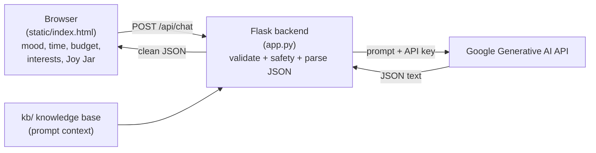

# JoyQuest

**"JoyQuest turns 'I should do something nice for myself' into three small things
you can actually do today."**

JoyQuest asks how you feel, how much time and money you have, and what you enjoy.
It then gives you **3 specific, doable joy quests** for today. You tick them off to
earn joy points and a daily streak. A **Joy Jar** stores your happy moments, and on a
rough day the app brings your own good memories back and suggests one small action.

This is a **mood-lifting tool, not therapy or medical advice.** If you express serious
distress, JoyQuest stops the quest flow and gently points you to a trusted person or a
local helpline.

---

## How it works (architecture)



1. The browser collects the user's mood, available time, budget, interests, and any
   saved Joy Jar memories.
2. **`app.py`** validates the input and runs a **safety check** before calling the AI.
3. If it's safe, the backend sends a prompt to **Google's Generative AI API** with the
   kb/ knowledge base included as context.
4. The backend strips markdown fences, parses the JSON, checks the shape, and retries
   once if the AI's reply wasn't valid. Then it returns clean JSON to the browser.

There is **no database and no login** — the browser (localStorage) remembers points,
streak, and the Joy Jar.

---

## Project layout

```
joyquest/
├── app.py                  # Flask backend (API + serves the frontend)
├── test_api.py             # Sends sample requests to a running server
├── requirements.txt        # flask, requests, gunicorn, python-dotenv
├── .env.example            # Template for the two secrets
├── .gitignore              # Excludes .env
├── static/
│   └── index.html          # The whole frontend (HTML + CSS + JS)
└── kb/                     # Knowledge base used as prompt context
    ├── joy_practices.md
    ├── micro_activities.md
    ├── kindness_ideas.md
    └── rough_day_playbook.md
```

---

## Setup

### 1. Install dependencies

```bash
python -m venv .venv
# Windows
.venv\Scripts\activate
# macOS / Linux
source .venv/bin/activate

pip install -r requirements.txt
```

### 2. Get your Google AI API key

1. Go to <https://aistudio.google.com/> (Google AI Studio) and sign in with your
   Google account.
2. Click **Get API key** → **Create API key** and copy the key it shows you.
   Keep it secret — you'll paste it into `.env` next.
3. Optionally choose a model in Google AI Studio; the app defaults to `gemini-pro`.
   You can override it with `GOOGLE_MODEL` in `.env`.

### 3. Add your secrets

Copy `.env.example` to `.env` and paste your Google AI API key:

```bash
cp .env.example .env    # Windows: copy .env.example .env
```

```dotenv
GOOGLE_API_KEY=your-google-ai-api-key
GOOGLE_MODEL=gemini-pro
```

**Where to paste:** open `.env`, put your Google AI API key after `GOOGLE_API_KEY=`
(and optionally change `GOOGLE_MODEL` to the model you want). `.env` is git-ignored
and never sent to the browser.

### 4. Run locally

```bash
python app.py
```

Open <http://localhost:5000>. The app serves the frontend and the API from the same
origin, so no CORS setup is needed. `GET /health` returns `{"ok": true}`.

### 5. Test the API (optional)

With the server running, in another terminal:

```bash
python test_api.py
```

This sends a sample `quests` request and a sample `rough_day` request and prints the
responses. Until you add your `.env` values, you'll get the friendly "not connected"
message instead of quests.

---

## API contract

`POST /api/chat`

**Request**

```json
{
  "task": "quests",
  "mood": "bored",
  "minutes": 30,
  "budget": "free",
  "interests": "music and being outside",
  "memories": ["Ate mango ice cream with friends"]
}
```

- `task`: `"quests"` or `"rough_day"`
- `mood`: `great` | `okay` | `low` | `stressed` | `bored`
- `minutes`: `10` | `30` | `60`
- `budget`: `free` | `under200` | `flexible`
- `interests`: free text (max 300 characters)
- `memories`: up to 10 short strings (max 200 characters each)

**Response — task `quests`**

```json
{
  "intro": "short friendly line",
  "quests": [
    {"title": "...", "description": "...", "minutes": 15, "cost": "free"}
  ],
  "closing": "short encouraging line"
}
```

**Response — task `rough_day`**

```json
{ "message": "a gentle message that mentions the user's memories", "suggestion": "one small action" }
```

**Response — safety check triggered**

```json
{ "safety": true, "message": "warm message encouraging the user to talk to a trusted person or helpline" }
```

**Error**

```json
{ "error": "friendly message the frontend can show" }
```

---

## Connecting the frontend

The frontend calls the backend directly in `static/index.html`:

```javascript
async function getQuests(mood, minutes, budget, interests, memories) {
  const r = await fetch("/api/chat", {
    method: "POST",
    headers: { "Content-Type": "application/json" },
    body: JSON.stringify({ task: "quests", mood, minutes, budget, interests, memories }),
  });
  const data = await r.json();
  if (data.error) throw new Error(data.error);
  return data; // intro, quests, closing — or safety/message
}
```

The rough-day call is the same with `task: "rough_day"`.

---

## Deployment

1. Push this folder to a GitHub repository (`.env` stays out — it's git-ignored).
2. Deploy it wherever you like (DigitalOcean App Platform, Render, Railway, etc.).
3. Run command: **`gunicorn app:app`**.
4. Add **environment variables** `GOOGLE_API_KEY` (and optionally `GOOGLE_MODEL`)
   in your hosting settings (do not upload `.env`).

---

## How we use Google AI

- **Google Generative AI API** — the conversational brain. The backend calls it at
  `https://generativelanguage.googleapis.com/v1beta/models/{model}:generateContent`
  with your `GOOGLE_API_KEY` as a query parameter. The key is read from environment
  variables and never sent to the browser.
- **Knowledge base context** — the four `kb/` Markdown files are included as prompt
  context so quests and messages are grounded in real joy practices, a large
  micro-activity list, kindness ideas, and a gentle rough-day playbook. This is what
  makes the quests specific instead of generic chatbot answers.

---

## Responsible design

- JoyQuest is a **mood-lifting tool, not therapy or medical advice**. The interface
  says so.
- A **safety check runs before the AI** on the user's free-text interests and Joy Jar
  memories. If it detects language about self-harm or wanting to die, it **skips the
  quest flow entirely** and returns a warm message encouraging the user to talk to a
  trusted person or a local crisis helpline (in India, Tele-MANAS: 14416).
- The agent is instructed to stay kind and non-preachy, to never invent research
  facts, and to redirect to real help on serious distress.
- **Privacy:** there is no login and no server-side database. Points, streak, and Joy
  Jar entries stay in the user's browser. Secrets never reach the browser.
- A simple **per-IP rate limit** (20 requests/minute) protects credits.
